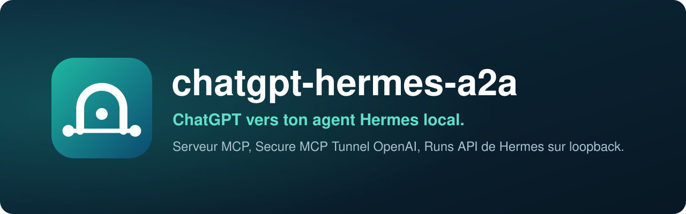
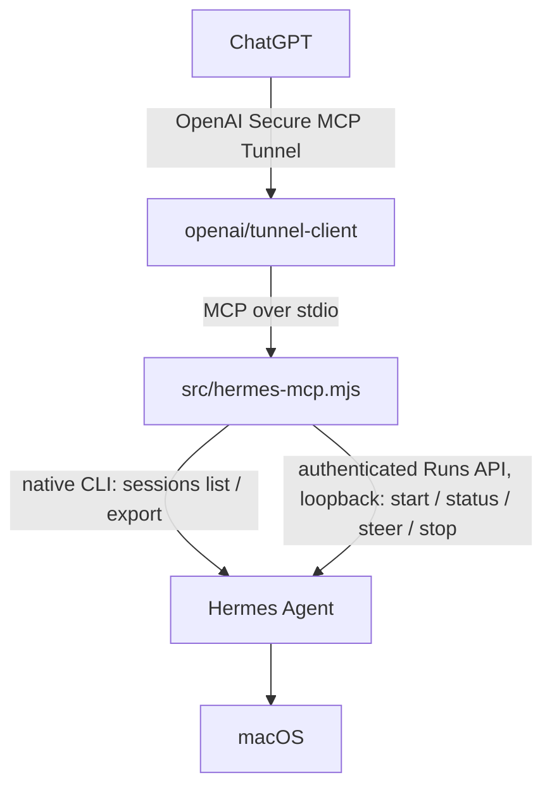

<div align="center">

[](README.md)


# chatgpt-hermes-a2a

**Drive your local Hermes agent from ChatGPT.**<br>
An MCP server connects ChatGPT, through OpenAI Secure MCP Tunnel, to Hermes' authenticated Runs API on your Mac. No port is exposed to the internet.

[](LICENSE)
[](#requirements)
[](https://nodejs.org)
[](https://modelcontextprotocol.io)
[](https://github.com/openai/tunnel-client)
[](https://github.com/NousResearch/hermes-agent)

</div>

<p align="center"></p>

> The repository name is historical: the bridge is **native-only** and no longer uses Hermes A2A (no port 9900, no A2A tools, no `@cognicellai/a2a-mcp` dependency). Created with Claude.

## Why

Hermes runs on your Mac, with your tools and your permissions. ChatGPT lives in the browser. This project gives them a safe path: you write your request in ChatGPT, Hermes runs it locally, and you follow, steer or stop the work from the same conversation.

Nothing is opened to the outside. `tunnel-client` makes an outbound connection to OpenAI and starts the MCP server locally over stdio; the server talks to Hermes over loopback with an API key.

## How it works



There is no A2A backend in the runtime path.

### The 12 MCP tools

The server exposes exactly 12 tools: the 10 original native tools plus two read-only ones (tool timeline and profile list).

| Tool | Purpose |
| --- | --- |
| `delegate_to_hermes` | Ordinary work in the durable Hermes session; waits up to 90 s, then hands back the active `runId` for polling |
| `list_hermes_sessions` | Discover persisted Hermes sessions |
| `get_hermes_session` | Read a persisted Hermes session |
| `continue_hermes_session` | Continue a specific durable Hermes session through the Runs API |
| `start_hermes_run` | Start controllable asynchronous work |
| `get_hermes_run` | Poll a Run |
| `steer_hermes_run` | Queue guidance into the active Run |
| `stop_hermes_run` | Stop the active Run |
| `hermes_status` | Check native Runs API capabilities (optionally for one `profile`) |
| `list_hermes_profiles` | List Hermes profiles with description, model and availability, so ChatGPT can pick one |
| `hermes_activity` | Read local redacted activity traces |
| `hermes_tool_timeline` | Read a content-free tool chronology for one session or Run (tool name, start/end, duration, ok/error kind) |

### Session model

For ChatGPT-scoped calls, the bridge uses `_meta["openai/session"]` only as a correlation key. The raw value is SHA-256 hashed immediately and never persisted.

The coordinator keeps one simple model per ChatGPT conversation:

```text
ChatGPT session hash
    -> canonical Hermes sessionId (once known)
    -> zero or one active runId
    -> bounded exact-retry replay
```

Invariants:

- only one mutating Hermes Run can be active per ChatGPT conversation (per slot, see below);
- the first `delegate_to_hermes` call may start without a `sessionId`;
- once Hermes returns a durable `sessionId`, later work reuses it automatically;
- a different explicit `sessionId` is rejected;
- ambiguous POST delivery keeps the conversation locked for an exact idempotent retry;
- a known active `runId` stays locked until a terminal Run state is observed;
- an exact normalized retry of the same in-flight operation reuses that active `runId` instead of returning `HERMES_SESSION_BUSY` or submitting duplicate work;
- synchronous delegation waits at most 90 seconds, then returns a successful nonterminal handoff (`pending: true`, `runId`, `pollWith: "get_hermes_run"`) while the Run continues locally;
- successful terminal results can be replayed for the bounded deduplication window, including across a bridge restart;
- failed, rejected, cancelled or interrupted results are never replayed as success;
- persisted replay payloads expire and are globally pruned.

One conversation can drive up to three **slots** (`slot` 1 to 3, default 1): each is its own durable Hermes session with one Run at a time. Ask for it explicitly in ChatGPT for two independent jobs in parallel; `get_hermes_run` with no arguments then waits on every busy slot. Details in [`docs/architecture.md`](docs/architecture.md).

Coordinator state is stored in:

```text
.runtime/chatgpt-session-coordinator.json
```

Cross-process state transactions are serialized by a local SQLite mutex at `.runtime/chatgpt-session-coordinator.json.mutex.sqlite`. The SQLite file contains no coordinator payload; it exists only to provide an OS-backed transaction lock that is released automatically if a bridge process exits. Hermes network reconciliation is performed outside that transaction and applied only after the active lease is revalidated.

Legacy version-1 mixed-route state and version-2 native single-replay state are migrated on load. Native session and Run state is preserved; old A2A context and task state is discarded. Version 3 stores every live replay result by operation fingerprint until the deduplication window expires.

## Install

```sh
curl -fsSL https://raw.githubusercontent.com/pyxl-dev/chatgpt-hermes-a2a/main/install.sh | sh
```

The installer puts the code in `~/.local/share/chatgpt-hermes-a2a` (or uses the clone you run it from), checks Node.js, Hermes and `tunnel-client`, and installs the single dependency (`@modelcontextprotocol/sdk` 1.30.0). It does not change the Hermes configuration and starts nothing. Run it again to update; `./install.sh --uninstall` removes the background service and the managed clone. It only touches your home folder.

Four steps remain, from the installed folder:

```sh
cd ~/.local/share/chatgpt-hermes-a2a
bash scripts/setup-hermes-control.sh   # enable Hermes' Runs API on loopback
npm test && npm run check              # check the bridge
bash scripts/connect-openai.sh         # guided first connection to ChatGPT
bash scripts/install-background.sh     # keep it running at login
```

Without the installer, this is equivalent to:

```sh
git clone https://github.com/pyxl-dev/chatgpt-hermes-a2a.git && cd chatgpt-hermes-a2a
npm install --no-package-lock --no-audit --no-fund
bash scripts/setup-hermes-control.sh
```

### Let your AI agent do it

Paste this into Claude Code, Codex, Cursor or any agent with a shell:

```text
Install and use chatgpt-hermes-a2a: https://github.com/pyxl-dev/chatgpt-hermes-a2a
Follow the AGENTS.md in that repository.
```

[`AGENTS.md`](AGENTS.md) tells the agent how to install it, when to use it, and the safety rules (never ask for the OpenAI key in chat, never expose Hermes' API).

### Requirements

| | Needed for |
| --- | --- |
| macOS | the background service (LaunchAgent) and the Keychain |
| [Node.js](https://nodejs.org) 22.13 or newer | the MCP server (the coordinator uses the built-in `node:sqlite`) |
| [Hermes Agent](https://github.com/NousResearch/hermes-agent) installed and working | the agent that does the work |
| Hermes API server enabled on loopback | `scripts/setup-hermes-control.sh` does it |
| OpenAI [`tunnel-client`](https://github.com/openai/tunnel-client) | the outbound link to ChatGPT (`brew install openai/tools/tunnel-client`, or `scripts/install-tunnel-client.sh`) |
| An OpenAI / ChatGPT workspace that supports the required MCP actions | creating the tunnel and the connector |

### Step-by-step setup

#### 1. Install Hermes

Use Hermes' official installer and make sure normal local use works before involving ChatGPT:

```sh
hermes --version
hermes
```

#### 2. Enable Hermes' native Runs API

The bridge requires Hermes' authenticated Runs API:

```sh
bash scripts/setup-hermes-control.sh
```

The script configures the API server on loopback, creates or finds the bearer key through Hermes' own configuration (it is never printed), restarts the Hermes gateway and checks the required capabilities. Then verify: `npm run smoke:control`.

The bridge launcher reads only two values from the active Hermes profile; it does not source the complete environment file:

- `API_SERVER_KEY`
- `API_SERVER_PORT`

#### 3. Create an OpenAI tunnel

In OpenAI Platform, create a Secure MCP Tunnel and associate it with the ChatGPT workspace that will use it. The runtime key must be able to read and use that tunnel (`Tunnels Read` and `Use`). Keep administrative tunnel credentials separate from this long-lived key. The runtime values are:

```sh
CONTROL_PLANE_TUNNEL_ID="tunnel_..."
CONTROL_PLANE_API_KEY="sk-..."
```

#### 4. Test the foreground connection

```sh
bash scripts/connect-openai.sh
```

The script opens the OpenAI pages, asks for the tunnel ID and then the key (hidden input, kept only in the process environment), starts `tunnel-client`, waits until it is ready and opens the ChatGPT connector settings. Keep the terminal open while testing. By hand, after exporting both variables: `bash scripts/start-tunnel.sh`.

The tunnel profile launches:

```text
/bin/bash /absolute/path/to/chatgpt-hermes-a2a/scripts/start-bridge.sh
```

Use one `tunnel-client` instance per tunnel ID.

#### 5. Configure ChatGPT

Create or refresh the custom MCP app with **Connection: Tunnel** on the same tunnel the runtime uses. After tool discovery, the app should expose exactly the 12 tools listed above. If old A2A tools (`continue_with_hermes`, `get_hermes_task`, `cancel_hermes_task`) still appear, restart the bridge on this build and refresh the MCP app.

#### 6. First tests from ChatGPT

Start read-only:

```text
Use my Hermes app and call hermes_status.
```

Then delegate something harmless:

```text
Use delegate_to_hermes and ask Hermes to inspect the current project status without modifying files.
```

`delegate_to_hermes` waits up to 90 seconds. If Hermes is still working, the tool returns `pending: true` with the active `runId` instead of failing the MCP call; continue with `get_hermes_run`. If the same call is retried while that Run is active, the bridge reuses the same `runId` instead of submitting the work again.

To find persisted sessions: `list_hermes_sessions`, `get_hermes_session`, `continue_hermes_session`. For long, controllable work: `start_hermes_run`, `get_hermes_run`, then optionally `steer_hermes_run` and `stop_hermes_run`.

#### 7. Keep the bridge running in the background

```sh
bash scripts/install-background.sh
bash scripts/status.sh
```

The script writes a LaunchAgent, stores the runtime key in the macOS Keychain and waits for the tunnel to be ready. The historical identifiers are kept so existing installations do not break; they are names only:

```text
LaunchAgent: com.pyxl.chatgpt-hermes-a2a
Keychain service: chatgpt-hermes-a2a.runtime-api-key
Tunnel profile: chatgpt-hermes-a2a
```

## Usage

### Hermes profiles

ChatGPT can choose which Hermes profile runs a task. It calls `list_hermes_profiles` to read each profile's description (from `profile.yaml`), then passes `profile` to `delegate_to_hermes`, `start_hermes_run` or `continue_hermes_session`. Without `profile`, work goes to the default profile, exactly as before.

The bridge reaches named profiles through Hermes' multiplexed gateway (`gateway.multiplex_profiles: true`) at `/p/<profile>/v1/...`. Hermes requires each profile's own `API_SERVER_KEY` there, so a profile is usable from ChatGPT only once it has one. That key is the opt-in:

```sh
bash scripts/setup-hermes-control.sh --profile rea --profile youtube
```

The gateway reads the key live; no restart is needed. The bridge reads only `API_SERVER_KEY` from `~/.hermes/profiles/<name>/.env` (override the Hermes root with `HERMES_ROOT_HOME`), never returns it, and `list_hermes_profiles` reports `available: false` for profiles without one.

A slot is bound to the profile of its Hermes session:

- follow-ups to a slot stay in its profile without repeating `profile`;
- `get_hermes_run`, `steer_hermes_run`, `stop_hermes_run` and the run-finished notifier route to the profile the Run was started in;
- asking a bound slot for another profile fails with `HERMES_PROFILE_MISMATCH` (use a free slot, or `replaceSession: true` to archive the old session and start a fresh one in the new profile);
- replay deduplication is namespaced per profile, and session ownership checks compare session ids within one profile.

`list_hermes_sessions`, `get_hermes_session` and `hermes_tool_timeline` accept `profile` too (they run `hermes -p <profile> sessions ...`).

### Message provenance header

Every instruction the bridge sends to Hermes (`start`, `continue`, `delegate` and `steer`) is prefixed with a header so Hermes knows the message comes from ChatGPT:

```text
[Message From ChatGPT]

<instruction>
```

Set `HERMES_MESSAGE_HEADER` to change the text, or to an empty string to disable it. The header is added only to the payload sent to Hermes; idempotency keys are still computed on the raw instruction.

### Run-finished notification

ChatGPT can only wait on a Run for as long as one assistant turn lasts (about 23 to 26 minutes). For Runs that outlive that turn, or that ChatGPT stopped polling, the bridge watches every Run it handed back as pending and, once it is terminal and no tool call has already returned it to ChatGPT, posts a short Discord message so you can come back and say "continue". The message holds only the status, the duration, a 120-character preview of the instruction and the `runId`: Hermes output never goes through this path.

The Discord webhook URL is read from the macOS Keychain (service `chatgpt-hermes-a2a.discord-webhook`) or from `HERMES_A2A_DISCORD_WEBHOOK_URL`. Without it, the notifier stays off. `HERMES_A2A_NOTIFY=off` turns it off explicitly.

### Environment variables

| Variable | Purpose |
| --- | --- |
| `API_SERVER_KEY` (or `HERMES_API_SERVER_KEY`), `API_SERVER_PORT` | bearer key and port of the Runs API (the launcher reads them from the Hermes configuration; port 8642 by default) |
| `HERMES_API_SERVER_URL` | full URL of the Runs API, overrides the port |
| `HERMES_BIN` | path to the `hermes` binary |
| `HERMES_ROOT_HOME` | Hermes root for per-profile keys (`~/.hermes/profiles/<name>/.env`) |
| `HERMES_MESSAGE_HEADER` | provenance header (empty to disable) |
| `HERMES_ACTIVITY_LOG`, `HERMES_ACTIVITY_MAX_BYTES`, `HERMES_ACTIVITY_BACKUPS`, `HERMES_ACTIVITY_READ_MAX_BYTES` | activity trace and its rotation |
| `HERMES_SESSION_COORDINATOR_STATE` | location of the coordinator state |
| `HERMES_DEDUP_WINDOW_MS` | replay deduplication window |
| `HERMES_NATIVE_DELEGATE_TIMEOUT_MS`, `HERMES_NATIVE_DELEGATE_POLL_MS`, `HERMES_NATIVE_RUN_POLL_WAIT_MS` | `delegate_to_hermes` wait (1 s minimum, capped at 90 s), poll interval (750 ms by default), `get_hermes_run` wait (55 s by default, capped at 90 s) |
| `HERMES_CONTROL_TIMEOUT_MS`, `HERMES_SESSION_TIMEOUT_MS` | timeouts for Runs API calls and the session CLI |
| `HERMES_A2A_NOTIFY`, `HERMES_A2A_DISCORD_WEBHOOK_URL`, `HERMES_A2A_NOTIFY_POLL_MS`, `HERMES_A2A_NOTIFY_GRACE_MS` | run-finished notifier |
| `A2A_LOG_MAX_BYTES`, `A2A_LOG_BACKUPS` | LaunchAgent log rotation |

### Maintenance

```sh
bash scripts/status.sh                # LaunchAgent, tunnel and Hermes state
bash scripts/restart.sh               # restart and show the state
bash scripts/stop.sh                  # stop for this login session (starts again at next login)
bash scripts/uninstall-background.sh  # remove the LaunchAgent
```

`uninstall-background.sh` keeps the runtime key in the Keychain; to remove it too: `DELETE_RUNTIME_KEY=1 bash scripts/uninstall-background.sh`.

Update:

```sh
cd ~/.local/share/chatgpt-hermes-a2a   # or your clone
git pull --ff-only
npm install --no-package-lock --no-audit --no-fund
npm test && npm run check && npm run smoke
bash scripts/restart.sh
```

If the public tool schema changed, refresh the MCP app in ChatGPT.

### Observability

Every public tool call appends a redacted trace to:

```text
.runtime/hermes-activity.jsonl
```

The trace stores a hash and a truncated, redacted preview of the instruction, not the full prompt. Read it from ChatGPT with `hermes_activity`.

That file is bounded: it rotates at `HERMES_ACTIVITY_MAX_BYTES` (default 2 MB) into `.runtime/hermes-activity.jsonl.1 … .N` (`HERMES_ACTIVITY_BACKUPS`, default 3), always mode `0600`, and `hermes_activity` reads across the rotated segments under an 8 MB budget (reporting `rotation.readTruncated` when older bytes were dropped).

The LaunchAgent logs are bounded the same way: `scripts/daemon-run.sh` starts the tunnel client through `src/bounded-log-runner.mjs`, so `~/Library/Logs/chatgpt-hermes-a2a.out.log` (and `.err.log`) rotate at `A2A_LOG_MAX_BYTES` (default 2 MB) with `A2A_LOG_BACKUPS` generations (default 3). The paths `scripts/status.sh` tails do not change.

Execution steps are readable per session with `hermes_tool_timeline`:

```text
hermes_tool_timeline { "sessionId": "run_…" }
hermes_tool_timeline { "sessionId": "run_…", "errorsOnly": true }
hermes_tool_timeline { "sessionId": "run_…", "tool": "terminal", "limit": 50 }
hermes_tool_timeline { "sessionId": "run_…", "since": "2026-10-10T00:00:00Z" }
hermes_tool_timeline { "runId": "run_…" }
```

Each entry carries `toolName`, `startedAt`, `endedAt`, `durationMs`, `ok`, `errorKind` (`blocked`, `denied`, `error` or `nonzero_exit`) and `state` (`completed`, `started_only` or `result_only`). The tool is derived from Hermes' own persisted session store, so it survives bridge restarts, and it never returns tool arguments, tool results, prompts, assistant text or reasoning.

The result is always session-scoped and says so: `scope: "session"`, `requestedRunId` (the caller's input, echoed), `runFilterApplied: false` and a `runFilterNote`. A `runId` only *locates* its session (the coordinator's active run when that exact run matches, otherwise the run-bound session id), because a continued session holds tool calls from several runs and nothing can attribute a call to one run with proof. No result is ever labelled as one run's timeline.

What is deliberately not collected: the live `/v1/runs/{id}/events` SSE stream (richer `tool.started` previews, but a 300-second transport buffer, not a store), any tool argument or result text, any prompt content, and anything leaving this machine: there is no OTLP, telemetry or cloud export.

### Troubleshooting

- **Native tools fail**: `bash scripts/setup-hermes-control.sh`, then `npm run smoke:control`.
- **The MCP server does not start**: `npm install --no-package-lock --no-audit --no-fund`, `npm run check`, then `bash scripts/start-bridge.sh`.
- **ChatGPT still shows old A2A tools**: restart the bridge on the new code, then refresh the MCP app.
- **Inconsistent behavior after a restart**: check there is only one `tunnel-client` process for the tunnel ID, with `bash scripts/status.sh`.
- **A Run timed out in ChatGPT but Hermes may still be working**: do not immediately resubmit different work. The coordinator persists the active `runId` when known and reconciles it before allowing another mutating operation.
- **An ambiguous POST returned no `runId`**: an exact retry is allowed with the same persisted idempotency scope; different work stays blocked until delivery is resolved (per slot).
- **`HERMES_RUN_CAPACITY_EXHAUSTED`**: Hermes is already running `api_server.max_concurrent_runs` Runs (10 by default) across all conversations. Nothing was submitted and the slot is free again: wait for a Run to finish, then retry.

### Upgrading from the former A2A bridge

The coordinator state schema is migrated automatically on first load. From version 3 (single session per conversation) to version 4 (slots), each conversation's binding, active Run and replay entries become slot 1 unchanged. Once a version-4 bridge has written the state file, an older build refuses it (unsupported version) rather than overwriting it; to roll back, restore the file from before the upgrade. Before switching the persistent runtime to this native build, stop any old A2A job you intentionally left running. The file `config/a2a-mcp.config.yaml` and the `@cognicellai/a2a-mcp` dependency are removed. Details in [`docs/getting-started.md`](docs/getting-started.md).

## Security

The trust boundaries are simple:

1. ChatGPT and OpenAI Secure MCP Tunnel;
2. `tunnel-client` and the local MCP server over stdio;
3. the server and Hermes' Runs API on loopback, or its session CLI.

No Hermes port is exposed publicly. The Runs API stays on loopback, bearer-authenticated. The tunnel gives ChatGPT access to the MCP server, not arbitrary network or shell access to the Mac.

This is still privileged local automation: Hermes can use whatever tools and permissions you have granted it. The main risks are untrusted instructions reaching a privileged agent, overly broad Hermes permissions, leaked tunnel or API credentials, duplicate execution after network ambiguity, concurrent local work from the same conversation and stale local state after a crash.

Do not put secrets in instructions to Hermes: replay persistence is for delivery safety, not a data-loss-prevention boundary. The 22 runtime invariants, the threat model and credential handling are detailed in [`docs/security.md`](docs/security.md).

## Development

```sh
git clone https://github.com/pyxl-dev/chatgpt-hermes-a2a.git && cd chatgpt-hermes-a2a
npm install --no-package-lock --no-audit --no-fund
npm test                # unit tests, no Hermes needed
npm run check           # syntax check
npm run smoke:control   # against a real Hermes: start, poll, steer, stop, cancel
npm run smoke           # against a real Hermes: the 12 tools, a harmless task, the timeline
bash scripts/run-all.sh # all of the above as one diagnostic
```

`npm test` covers the native coordinator, control idempotency, observability, log rotation, the bounded LaunchAgent log runner and the content-free tool timeline. `npm run smoke` starts the MCP server over stdio, verifies the exact 12-tool native surface, checks Hermes' status and session discovery, delegates a harmless real task, verifies Hermes used a local tool, then reads the run's content-free tool timeline. CI (`.github/workflows/pr-checks.yml`) runs `npm test` and `npm run check` on Node 22.16.0 and 26.

| File | |
| --- | --- |
| `src/hermes-mcp.mjs` | MCP server (stdio) and the 12 tool definitions |
| `src/hermes-session-coordinator.mjs` | slots, locks, idempotency and replay |
| `src/hermes-control.mjs` | Hermes Runs API client |
| `src/hermes-sessions.mjs` | session access through the Hermes CLI |
| `src/hermes-profiles.mjs` | Hermes profiles and per-profile keys |
| `src/hermes-observability.mjs`, `src/hermes-log-rotation.mjs` | activity traces and rotation |
| `src/hermes-run-notifier.mjs` | Discord run-finished notification |
| `src/bounded-log-runner.mjs` | bounded-log launcher for the LaunchAgent |
| `src/mcp-smoke.mjs`, `src/mcp-control-smoke.mjs` | smoke tests against a real Hermes |
| `scripts/` | install, Hermes setup, tunnel, background service, status |
| `docs/` | [getting started](docs/getting-started.md), [architecture](docs/architecture.md), [security](docs/security.md) |
| `AGENTS.md` | instructions for any AI agent |
| `install.sh` | installer |

## License

[MIT](LICENSE)
