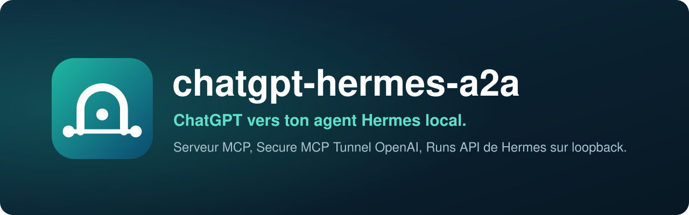
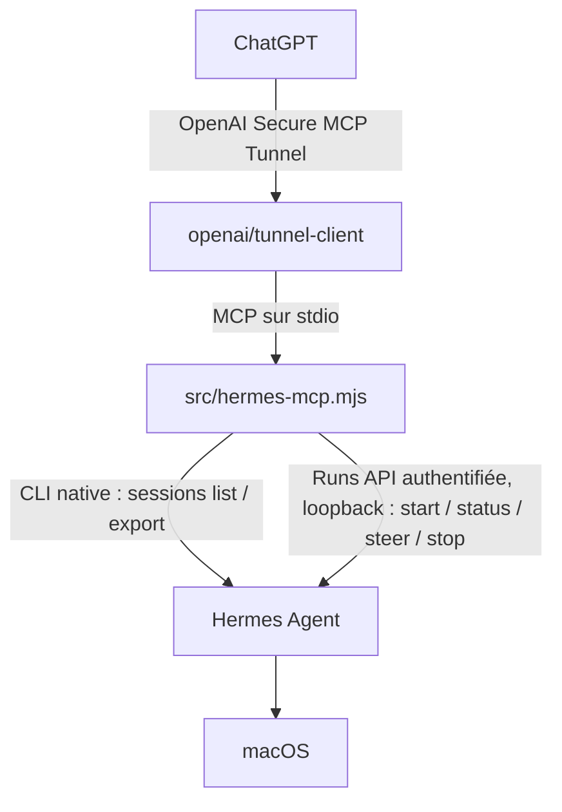

<div align="center">

[](README.en.md)


# chatgpt-hermes-a2a

**Pilote ton agent Hermes local depuis ChatGPT.**<br>
Un serveur MCP relie ChatGPT, via OpenAI Secure MCP Tunnel, à l'API Runs authentifiée de Hermes sur ton Mac. Aucun port n'est exposé sur Internet.

[](LICENSE)
[](#prérequis)
[](https://nodejs.org)
[](https://modelcontextprotocol.io)
[](https://github.com/openai/tunnel-client)
[](https://github.com/NousResearch/hermes-agent)

</div>

<p align="center"></p>

> Le nom du dépôt est historique : le pont est **100 % natif** et n'utilise plus Hermes A2A (pas de port 9900, pas d'outils A2A, pas de dépendance `@cognicellai/a2a-mcp`). Créé avec Claude.

## Pourquoi

Hermes tourne sur ton Mac, avec tes outils et tes permissions. ChatGPT, lui, vit dans le navigateur. Ce projet leur donne un chemin sûr : tu écris ta demande dans ChatGPT, Hermes l'exécute en local, et tu suis, guides ou arrêtes le travail depuis la même conversation.

Rien n'est ouvert vers l'extérieur. `tunnel-client` établit une connexion sortante vers OpenAI et lance le serveur MCP en local sur stdio ; le serveur parle à Hermes sur la boucle locale, avec une clé d'API.

## Comment ça marche



Il n'y a aucun backend A2A dans le chemin d'exécution.

### Les 12 outils MCP

Le serveur expose exactement 12 outils : les 10 outils natifs d'origine, plus deux outils en lecture seule (chronologie des outils et liste des profils).

| Outil | Rôle |
| --- | --- |
| `delegate_to_hermes` | Travail courant dans la session Hermes durable ; attend jusqu'à 90 s, puis rend le `runId` actif à interroger |
| `list_hermes_sessions` | Découvre les sessions Hermes enregistrées |
| `get_hermes_session` | Lit une session Hermes enregistrée |
| `continue_hermes_session` | Continue une session Hermes précise via l'API Runs |
| `start_hermes_run` | Lance un travail asynchrone pilotable |
| `get_hermes_run` | Interroge un Run |
| `steer_hermes_run` | Met une consigne en file dans le Run actif |
| `stop_hermes_run` | Arrête le Run actif |
| `hermes_status` | Vérifie les capacités de l'API Runs native (pour un `profile` donné si besoin) |
| `list_hermes_profiles` | Liste les profils Hermes (description, modèle, disponibilité) pour que ChatGPT en choisisse un |
| `hermes_activity` | Lit les traces d'activité locales, expurgées |
| `hermes_tool_timeline` | Lit la chronologie des outils d'une session ou d'un Run, sans contenu (nom, début, fin, durée, ok ou type d'erreur) |

### Modèle de session

Pour les appels venant de ChatGPT, le pont utilise `_meta["openai/session"]` uniquement comme clé de corrélation. La valeur brute est hachée en SHA-256 tout de suite et n'est jamais enregistrée.

Le coordinateur tient un modèle simple par conversation ChatGPT :

```text
hash de la session ChatGPT
    -> sessionId Hermes canonique (une fois connu)
    -> zéro ou un runId actif
    -> rejeu borné des retries exacts
```

Invariants :

- un seul Run mutant actif par conversation ChatGPT (par slot, voir plus bas) ;
- le premier `delegate_to_hermes` peut démarrer sans `sessionId` ;
- dès que Hermes rend un `sessionId` durable, les travaux suivants le réutilisent automatiquement ;
- un autre `sessionId` explicite est refusé ;
- une livraison POST ambiguë garde la conversation verrouillée pour un retry exact et idempotent ;
- un `runId` actif connu reste verrouillé jusqu'à ce qu'un état terminal soit observé ;
- un retry exact et normalisé de la même opération en cours réutilise le `runId` actif au lieu de renvoyer `HERMES_SESSION_BUSY` ou de soumettre le travail en double ;
- la délégation synchrone attend 90 secondes au plus, puis rend un passage de relais réussi non terminal (`pending: true`, `runId`, `pollWith: "get_hermes_run"`) pendant que le Run continue en local ;
- les résultats terminaux réussis peuvent être rejoués pendant la fenêtre de déduplication, y compris après un redémarrage du pont ;
- les résultats échoués, rejetés, annulés ou interrompus ne sont jamais rejoués comme des succès ;
- les payloads de rejeu persistés expirent et sont purgés globalement.

Une conversation peut piloter jusqu'à trois **slots** (`slot` 1 à 3, 1 par défaut) : chacun est sa propre session Hermes durable avec un Run à la fois. Demande-le explicitement dans ChatGPT pour deux travaux indépendants en parallèle ; `get_hermes_run` sans argument attend alors tous les slots occupés. Le détail est dans [`docs/architecture.md`](docs/architecture.md).

L'état du coordinateur est stocké dans :

```text
.runtime/chatgpt-session-coordinator.json
```

Les transactions d'état entre processus sont sérialisées par un mutex SQLite local, `.runtime/chatgpt-session-coordinator.json.mutex.sqlite`. Ce fichier ne contient aucun payload du coordinateur : il sert seulement de verrou de transaction géré par l'OS, libéré automatiquement si un processus du pont se termine. La réconciliation réseau avec Hermes se fait hors de la transaction et n'est appliquée qu'après revalidation du bail actif.

Les anciens états version 1 (route mixte) et version 2 (rejeu natif unique) sont migrés au chargement. L'état natif des sessions et des Runs est conservé, l'ancien état de contexte et de tâche A2A est abandonné. La version 3 garde chaque résultat rejouable par empreinte d'opération jusqu'à la fin de la fenêtre de déduplication.

## Installation

```sh
curl -fsSL https://raw.githubusercontent.com/pyxl-dev/chatgpt-hermes-a2a/main/install.sh | sh
```

L'installateur met le code dans `~/.local/share/chatgpt-hermes-a2a` (ou utilise le clone d'où tu le lances), vérifie Node.js, Hermes et `tunnel-client`, puis installe l'unique dépendance (`@modelcontextprotocol/sdk` 1.30.0). Il ne modifie pas la configuration de Hermes et ne démarre rien. Relance-le pour mettre à jour ; `./install.sh --uninstall` enlève le service d'arrière-plan et le clone géré. Il ne touche qu'à ton dossier perso.

Il te reste ensuite quatre étapes, depuis le dossier installé :

```sh
cd ~/.local/share/chatgpt-hermes-a2a
bash scripts/setup-hermes-control.sh   # active l'API Runs de Hermes sur loopback
npm test && npm run check              # vérifie le pont
bash scripts/connect-openai.sh         # première connexion guidée à ChatGPT
bash scripts/install-background.sh     # garde le tout actif à l'ouverture de session
```

Sans l'installateur, c'est équivalent à :

```sh
git clone https://github.com/pyxl-dev/chatgpt-hermes-a2a.git && cd chatgpt-hermes-a2a
npm install --no-package-lock --no-audit --no-fund
bash scripts/setup-hermes-control.sh
```

### Laisse ton agent IA s'en occuper

Colle ceci dans Claude Code, Codex, Cursor ou n'importe quel agent qui a accès à un terminal :

```text
Installe et utilise chatgpt-hermes-a2a : https://github.com/pyxl-dev/chatgpt-hermes-a2a
Suis le fichier AGENTS.md de ce dépôt.
```

[`AGENTS.md`](AGENTS.md) explique à l'agent comment l'installer, quand s'en servir, et les règles de sécurité (ne jamais demander la clé OpenAI dans le chat, ne jamais exposer l'API de Hermes). Il est en anglais, la langue que tous les agents lisent.

### Prérequis

| | Sert à |
| --- | --- |
| macOS | le service d'arrière-plan (LaunchAgent) et le trousseau |
| [Node.js](https://nodejs.org) 22.13 ou plus | le serveur MCP (le coordinateur utilise le module intégré `node:sqlite`) |
| [Hermes Agent](https://github.com/NousResearch/hermes-agent) installé et fonctionnel | l'agent qui exécute le travail |
| API server de Hermes activé sur loopback | `scripts/setup-hermes-control.sh` s'en charge |
| [`tunnel-client`](https://github.com/openai/tunnel-client) d'OpenAI | le lien sortant vers ChatGPT (`brew install openai/tools/tunnel-client`, ou `scripts/install-tunnel-client.sh`) |
| Un espace OpenAI / ChatGPT qui gère les actions MCP nécessaires | créer le tunnel et le connecteur |

### Configuration pas à pas

#### 1. Installer Hermes

Passe par l'installateur officiel de Hermes et vérifie que l'usage local fonctionne avant de brancher ChatGPT :

```sh
hermes --version
hermes
```

#### 2. Activer l'API Runs native de Hermes

Le pont exige l'API Runs authentifiée de Hermes :

```sh
bash scripts/setup-hermes-control.sh
```

Le script configure l'API server sur loopback, crée ou retrouve la clé bearer par la configuration de Hermes lui-même (elle n'est jamais affichée), redémarre la passerelle Hermes et vérifie les capacités attendues. Vérifie ensuite : `npm run smoke:control`.

Le lanceur du pont ne lit que deux valeurs dans le profil Hermes actif, il ne source pas tout le fichier d'environnement :

- `API_SERVER_KEY`
- `API_SERVER_PORT`

#### 3. Créer le tunnel OpenAI

Dans OpenAI Platform, crée un Secure MCP Tunnel et associe-le à l'espace ChatGPT qui l'utilisera. La clé d'exécution doit pouvoir lire et utiliser ce tunnel (droits `Tunnels Read` et `Use`). Garde les identifiants d'administration du tunnel séparés de cette clé, qui reste en place longtemps. Les valeurs d'exécution sont :

```sh
CONTROL_PLANE_TUNNEL_ID="tunnel_..."
CONTROL_PLANE_API_KEY="sk-..."
```

#### 4. Tester la connexion au premier plan

```sh
bash scripts/connect-openai.sh
```

Le script ouvre les pages OpenAI, te demande l'ID du tunnel puis la clé (saisie masquée, gardée seulement dans l'environnement du processus), lance `tunnel-client`, attend qu'il soit prêt et ouvre les réglages des connecteurs ChatGPT. Garde le terminal ouvert pendant les essais. En manuel, après avoir exporté les deux variables : `bash scripts/start-tunnel.sh`.

Le profil du tunnel lance :

```text
/bin/bash /chemin/absolu/vers/chatgpt-hermes-a2a/scripts/start-bridge.sh
```

Utilise une seule instance de `tunnel-client` par ID de tunnel.

#### 5. Configurer ChatGPT

Crée ou rafraîchis le connecteur MCP personnalisé avec **Connection: Tunnel**, sur le même tunnel que celui du runtime. Après la découverte des outils, l'app doit exposer exactement les 12 outils listés plus haut. Si d'anciens outils A2A (`continue_with_hermes`, `get_hermes_task`, `cancel_hermes_task`) apparaissent encore, redémarre le pont sur cette version puis rafraîchis le connecteur.

#### 6. Premiers essais depuis ChatGPT

Commence en lecture seule :

```text
Utilise mon app Hermes et appelle hermes_status.
```

Puis délègue quelque chose d'inoffensif :

```text
Utilise delegate_to_hermes et demande à Hermes d'inspecter l'état du projet en cours sans modifier de fichier.
```

`delegate_to_hermes` attend 90 secondes. Si Hermes travaille encore, l'outil rend `pending: true` avec le `runId` actif au lieu de faire échouer l'appel MCP ; continue avec `get_hermes_run`. Si le même appel est réessayé pendant que ce Run est actif, le pont réutilise le même `runId` sans soumettre le travail une seconde fois.

Pour retrouver des sessions enregistrées : `list_hermes_sessions`, `get_hermes_session`, `continue_hermes_session`. Pour un travail long et pilotable : `start_hermes_run`, `get_hermes_run`, puis au besoin `steer_hermes_run` et `stop_hermes_run`.

#### 7. Garder le pont actif en arrière-plan

```sh
bash scripts/install-background.sh
bash scripts/status.sh
```

Le script écrit un LaunchAgent, range la clé d'exécution dans le trousseau macOS et attend que le tunnel soit prêt. Les identifiants historiques sont conservés pour ne pas casser les installations existantes ; ce ne sont que des noms :

```text
LaunchAgent : com.pyxl.chatgpt-hermes-a2a
Service du trousseau : chatgpt-hermes-a2a.runtime-api-key
Profil du tunnel : chatgpt-hermes-a2a
```

## Utilisation

### Profils Hermes

ChatGPT peut choisir le profil Hermes qui exécute une tâche. Il appelle `list_hermes_profiles` pour lire la description de chaque profil (dans `profile.yaml`), puis passe `profile` à `delegate_to_hermes`, `start_hermes_run` ou `continue_hermes_session`. Sans `profile`, le travail va au profil par défaut, comme avant.

Le pont atteint les profils nommés par la passerelle multiplexée de Hermes (`gateway.multiplex_profiles: true`), sur `/p/<profil>/v1/...`. Hermes y exige la propre `API_SERVER_KEY` de chaque profil : un profil n'est donc utilisable depuis ChatGPT qu'une fois qu'il en a une. Cette clé est l'opt-in :

```sh
bash scripts/setup-hermes-control.sh --profile rea --profile youtube
```

La passerelle lit la clé à la volée, sans redémarrage. Le pont ne lit que `API_SERVER_KEY` dans `~/.hermes/profiles/<nom>/.env` (change la racine Hermes avec `HERMES_ROOT_HOME`), ne la renvoie jamais, et `list_hermes_profiles` indique `available: false` pour un profil sans clé.

Un slot est lié au profil de sa session Hermes :

- les suites d'un slot restent dans son profil sans répéter `profile` ;
- `get_hermes_run`, `steer_hermes_run`, `stop_hermes_run` et le notificateur de fin de Run vont vers le profil où le Run a démarré ;
- demander un autre profil à un slot lié échoue avec `HERMES_PROFILE_MISMATCH` (utilise un slot libre, ou `replaceSession: true` pour archiver l'ancienne session et en démarrer une neuve dans le nouveau profil) ;
- la déduplication des rejeux est cloisonnée par profil, et les contrôles de propriété de session comparent les ids à l'intérieur d'un profil.

`list_hermes_sessions`, `get_hermes_session` et `hermes_tool_timeline` acceptent aussi `profile` (ils lancent `hermes -p <profil> sessions ...`).

### En-tête de provenance

Chaque consigne que le pont envoie à Hermes (`start`, `continue`, `delegate` et `steer`) est préfixée d'un en-tête, pour que Hermes sache que le message vient de ChatGPT :

```text
[Message From ChatGPT]

<consigne>
```

Change le texte avec `HERMES_MESSAGE_HEADER`, ou mets une chaîne vide pour le désactiver. L'en-tête n'est ajouté qu'au payload envoyé à Hermes : les clés d'idempotence restent calculées sur la consigne brute.

### Notification de fin de Run

ChatGPT ne peut attendre un Run que le temps d'un tour d'assistant (environ 23 à 26 minutes). Pour les Runs qui dépassent ce délai ou que ChatGPT a cessé d'interroger, le pont surveille chaque Run rendu comme en attente et, une fois qu'il est terminal sans qu'aucun appel d'outil l'ait déjà renvoyé à ChatGPT, poste un court message Discord pour que tu reviennes dire « continue ». Le message ne contient que le statut, la durée, un aperçu de 120 caractères de la consigne et le `runId` : la sortie de Hermes ne passe jamais par là.

L'URL du webhook Discord est lue dans le trousseau macOS (service `chatgpt-hermes-a2a.discord-webhook`) ou dans `HERMES_A2A_DISCORD_WEBHOOK_URL`. Sans elle, le notificateur reste éteint. `HERMES_A2A_NOTIFY=off` le coupe explicitement.

### Variables d'environnement

| Variable | Rôle |
| --- | --- |
| `API_SERVER_KEY` (ou `HERMES_API_SERVER_KEY`), `API_SERVER_PORT` | clé bearer et port de l'API Runs (le lanceur les lit dans la configuration Hermes ; port 8642 par défaut) |
| `HERMES_API_SERVER_URL` | URL complète de l'API Runs, qui remplace le port |
| `HERMES_BIN` | chemin du binaire `hermes` |
| `HERMES_ROOT_HOME` | racine Hermes pour les clés de profil (`~/.hermes/profiles/<nom>/.env`) |
| `HERMES_MESSAGE_HEADER` | en-tête de provenance (vide pour le désactiver) |
| `HERMES_ACTIVITY_LOG`, `HERMES_ACTIVITY_MAX_BYTES`, `HERMES_ACTIVITY_BACKUPS`, `HERMES_ACTIVITY_READ_MAX_BYTES` | trace d'activité et rotation |
| `HERMES_SESSION_COORDINATOR_STATE` | emplacement de l'état du coordinateur |
| `HERMES_DEDUP_WINDOW_MS` | fenêtre de déduplication des rejeux |
| `HERMES_NATIVE_DELEGATE_TIMEOUT_MS`, `HERMES_NATIVE_DELEGATE_POLL_MS`, `HERMES_NATIVE_RUN_POLL_WAIT_MS` | attente de `delegate_to_hermes` (1 s minimum, plafonnée à 90 s), intervalle d'interrogation (750 ms par défaut), attente d'un `get_hermes_run` (55 s par défaut, plafonnée à 90 s) |
| `HERMES_CONTROL_TIMEOUT_MS`, `HERMES_SESSION_TIMEOUT_MS` | délais des appels à l'API Runs et à la CLI de sessions |
| `HERMES_A2A_NOTIFY`, `HERMES_A2A_DISCORD_WEBHOOK_URL`, `HERMES_A2A_NOTIFY_POLL_MS`, `HERMES_A2A_NOTIFY_GRACE_MS` | notificateur de fin de Run |
| `A2A_LOG_MAX_BYTES`, `A2A_LOG_BACKUPS` | rotation des journaux du LaunchAgent |

### Maintenance

```sh
bash scripts/status.sh                # état du LaunchAgent, du tunnel et de Hermes
bash scripts/restart.sh               # redémarre et affiche l'état
bash scripts/stop.sh                  # arrête pour cette session (reprend à la prochaine ouverture)
bash scripts/uninstall-background.sh  # retire le LaunchAgent
```

`uninstall-background.sh` garde la clé d'exécution dans le trousseau ; pour la supprimer aussi : `DELETE_RUNTIME_KEY=1 bash scripts/uninstall-background.sh`.

Mise à jour :

```sh
cd ~/.local/share/chatgpt-hermes-a2a   # ou ton clone
git pull --ff-only
npm install --no-package-lock --no-audit --no-fund
npm test && npm run check && npm run smoke
bash scripts/restart.sh
```

Si le schéma public des outils a changé, rafraîchis le connecteur MCP dans ChatGPT.

### Observabilité

Chaque appel d'outil public ajoute une trace expurgée dans :

```text
.runtime/hermes-activity.jsonl
```

La trace garde un hachage et un aperçu tronqué et expurgé de la consigne, pas le prompt complet. Lis-la depuis ChatGPT avec `hermes_activity`.

Ce fichier est borné : il tourne à `HERMES_ACTIVITY_MAX_BYTES` (2 Mo par défaut) vers `.runtime/hermes-activity.jsonl.1 … .N` (`HERMES_ACTIVITY_BACKUPS`, 3 par défaut), toujours en mode `0600`, et `hermes_activity` lit à travers les segments tournés dans un budget de 8 Mo (en signalant `rotation.readTruncated` quand des octets plus anciens ont été écartés).

Les journaux du LaunchAgent sont bornés de la même façon : `scripts/daemon-run.sh` lance le client du tunnel via `src/bounded-log-runner.mjs`, donc `~/Library/Logs/chatgpt-hermes-a2a.out.log` (et `.err.log`) tournent à `A2A_LOG_MAX_BYTES` (2 Mo par défaut) avec `A2A_LOG_BACKUPS` générations (3 par défaut). Les chemins suivis par `scripts/status.sh` ne changent pas.

Les étapes d'exécution se lisent par session avec `hermes_tool_timeline` :

```text
hermes_tool_timeline { "sessionId": "run_…" }
hermes_tool_timeline { "sessionId": "run_…", "errorsOnly": true }
hermes_tool_timeline { "sessionId": "run_…", "tool": "terminal", "limit": 50 }
hermes_tool_timeline { "sessionId": "run_…", "since": "2026-10-10T00:00:00Z" }
hermes_tool_timeline { "runId": "run_…" }
```

Chaque entrée porte `toolName`, `startedAt`, `endedAt`, `durationMs`, `ok`, `errorKind` (`blocked`, `denied`, `error` ou `nonzero_exit`) et `state` (`completed`, `started_only` ou `result_only`). L'outil s'appuie sur le magasin de sessions de Hermes, donc il survit aux redémarrages du pont, et il ne rend jamais d'arguments d'outil, de résultats d'outil, de prompts, de texte de l'assistant ni de raisonnement.

Le résultat est toujours limité à la session, et le dit : `scope: "session"`, `requestedRunId` (l'entrée de l'appelant, répétée), `runFilterApplied: false` et un `runFilterNote`. Un `runId` ne fait que *localiser* sa session (le Run actif du coordinateur quand il correspond exactement, sinon la session liée au Run), car une session continuée contient les appels d'outils de plusieurs Runs et rien ne permet d'en attribuer un à un Run avec certitude. Aucun résultat n'est jamais présenté comme la chronologie d'un seul Run.

Ce qui n'est volontairement pas collecté : le flux SSE `/v1/runs/{id}/events` en direct (des aperçus `tool.started` plus riches, mais un tampon de transport de 300 secondes, pas un magasin), tout texte d'argument ou de résultat d'outil, tout contenu de prompt, et tout ce qui quitterait la machine : il n'y a ni OTLP, ni télémétrie, ni export cloud.

### Dépannage

- **Les outils natifs échouent** : `bash scripts/setup-hermes-control.sh` puis `npm run smoke:control`.
- **Le serveur MCP ne démarre pas** : `npm install --no-package-lock --no-audit --no-fund`, `npm run check`, puis `bash scripts/start-bridge.sh`.
- **ChatGPT affiche encore d'anciens outils A2A** : redémarre le pont sur le nouveau code, puis rafraîchis le connecteur MCP.
- **Comportement incohérent après un redémarrage** : vérifie qu'il n'y a qu'un processus `tunnel-client` pour l'ID de tunnel, avec `bash scripts/status.sh`.
- **Un Run a expiré dans ChatGPT mais Hermes travaille peut-être encore** : ne renvoie pas tout de suite un travail différent. Le coordinateur garde le `runId` actif quand il le connaît et le réconcilie avant d'autoriser une autre opération mutante.
- **Un POST ambigu n'a pas rendu de `runId`** : un retry exact est permis avec le même périmètre d'idempotence ; un travail différent reste bloqué tant que la livraison n'est pas tranchée (par slot).
- **`HERMES_RUN_CAPACITY_EXHAUSTED`** : Hermes fait déjà tourner `api_server.max_concurrent_runs` Runs (10 par défaut) toutes conversations confondues. Rien n'a été soumis et le slot est libre : attends la fin d'un Run, puis réessaie.

### Migration depuis l'ancien pont A2A

Le schéma d'état du coordinateur est migré automatiquement au premier chargement. De la version 3 (une session par conversation) à la version 4 (slots), la liaison, le Run actif et les entrées de rejeu de chaque conversation deviennent le slot 1, inchangés. Une fois qu'un pont en version 4 a écrit le fichier d'état, un ancien build le refuse (version non gérée) au lieu de l'écraser ; pour revenir en arrière, restaure le fichier d'avant la mise à jour. Avant de passer le runtime persistant sur ce build natif, arrête tout ancien job A2A laissé tourner volontairement. Le fichier `config/a2a-mcp.config.yaml` et la dépendance `@cognicellai/a2a-mcp` ont été supprimés. Détails dans [`docs/getting-started.md`](docs/getting-started.md).

## Sécurité

Les frontières de confiance sont simples :

1. ChatGPT et OpenAI Secure MCP Tunnel ;
2. `tunnel-client` et le serveur MCP local sur stdio ;
3. le serveur et l'API Runs de Hermes sur loopback, ou sa CLI de sessions.

Aucun port Hermes n'est exposé publiquement. L'API Runs reste sur loopback, protégée par une clé bearer. Le tunnel donne à ChatGPT l'accès au serveur MCP, pas un accès réseau ou shell libre au Mac.

Il s'agit quand même d'une automatisation locale privilégiée : Hermes peut utiliser tous les outils et permissions que tu lui as accordés. Les risques principaux sont des consignes non fiables qui atteignent un agent privilégié, des permissions Hermes trop larges, des identifiants de tunnel ou d'API qui fuient, une exécution en double après une ambiguïté réseau, un travail local concurrent depuis la même conversation et un état local périmé après un crash.

Ne mets pas de secrets dans les consignes à Hermes : le rejeu persisté sert la sûreté de livraison, pas la protection contre la fuite de données. Les 22 invariants d'exécution, le modèle de menace et la gestion des identifiants sont détaillés dans [`docs/security.md`](docs/security.md).

## Développement

```sh
git clone https://github.com/pyxl-dev/chatgpt-hermes-a2a.git && cd chatgpt-hermes-a2a
npm install --no-package-lock --no-audit --no-fund
npm test                # tests unitaires, sans Hermes
npm run check           # vérification de syntaxe
npm run smoke:control   # contre un vrai Hermes : démarrage, interrogation, pilotage, arrêt, annulation
npm run smoke           # contre un vrai Hermes : les 12 outils, une tâche inoffensive, la chronologie
bash scripts/run-all.sh # tout ce qui précède en un diagnostic
```

`npm test` couvre le coordinateur natif, l'idempotence du contrôle, l'observabilité, la rotation des journaux, le lanceur de journaux borné du LaunchAgent et la chronologie des outils sans contenu. `npm run smoke` démarre le serveur MCP sur stdio, vérifie la surface native exacte de 12 outils, contrôle le statut et la découverte de sessions de Hermes, délègue une vraie tâche inoffensive, vérifie que Hermes a utilisé un outil local, puis lit la chronologie sans contenu du Run. La CI (`.github/workflows/pr-checks.yml`) lance `npm test` et `npm run check` sous Node 22.16.0 et 26.

| Fichier | |
| --- | --- |
| `src/hermes-mcp.mjs` | serveur MCP (stdio) et définition des 12 outils |
| `src/hermes-session-coordinator.mjs` | slots, verrous, idempotence et rejeu |
| `src/hermes-control.mjs` | client de l'API Runs de Hermes |
| `src/hermes-sessions.mjs` | accès aux sessions par la CLI Hermes |
| `src/hermes-profiles.mjs` | profils Hermes et clés par profil |
| `src/hermes-observability.mjs`, `src/hermes-log-rotation.mjs` | traces d'activité et rotation |
| `src/hermes-run-notifier.mjs` | notification Discord de fin de Run |
| `src/bounded-log-runner.mjs` | lanceur à journaux bornés du LaunchAgent |
| `src/mcp-smoke.mjs`, `src/mcp-control-smoke.mjs` | tests de fumée contre un vrai Hermes |
| `scripts/` | installation, configuration de Hermes, tunnel, service d'arrière-plan, état |
| `docs/` | [démarrage](docs/getting-started.md), [architecture](docs/architecture.md), [sécurité](docs/security.md) |
| `AGENTS.md` | instructions pour n'importe quel agent IA |
| `install.sh` | installateur |

## Licence

[MIT](LICENSE)
